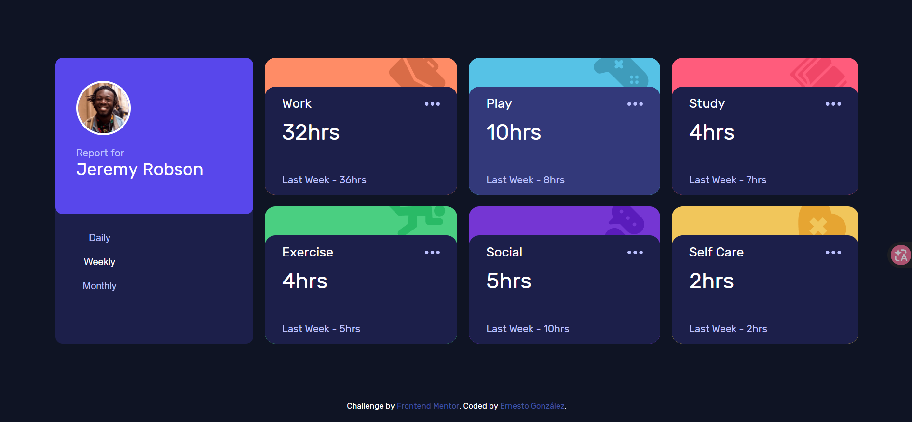

# Frontend Mentor - Time tracking dashboard solution

Esta es mi solución al reto [Time tracking dashboard challenge on Frontend Mentor](https://www.frontendmentor.io/challenges/time-tracking-dashboard-UIQ7167Jw). Los retos de Frontend Mentor ayudan a mejorar las habilidades de desarrollo construyendo proyectos realistas.

## Tabla de contenidos

- [Vista general](#vista-general)
  - [El reto](#el-reto)
  - [Captura de pantalla](#captura-de-pantalla)
  - [Enlaces](#enlaces)
- [Mi proceso](#mi-proceso)
  - [Construido con](#construido-con)
  - [Lo que aprendí](#lo-que-aprendí)
  - [Colaboración con IA](#colaboración-con-ia)
- [Autor](#autor)

## Vista general

### El reto

Los usuarios deben poder:

- Ver el diseño optimizado para la página según el tamaño de pantalla de su dispositivo (Diseño Responsivo con CSS Grid).
- Ver estados de "hover" y selección activa en los botones e interacciones.
- Alternar dinámicamente entre las estadísticas diarias (Daily), semanales (Weekly) y mensuales (Monthly).

### Captura de pantalla



### Enlaces

- URL de la solución: [Añadir URL de la solución aquí](https://github.com/YeiYei98/time-dashboard-main.git)
- URL del sitio en vivo: [Añadir URL del sitio en vivo aquí](https://yeiyei98.github.io/time-dashboard-main/)

## Mi proceso

### Construido con

- Marcado HTML5 semántico
- Propiedades personalizadas de CSS (Variables `:root`)
- CSS Grid y Flexbox
- Enfoque Mobile-first
- JavaScript Vanilla (ES6+) con manipulación dinámica del DOM
- Fetch API (`async/await`) para consumo de JSON local
- Fuente **Rubik** importada desde Google Fonts

### Lo que aprendí

Durante el desarrollo de este proyecto afiancé varios conceptos clave de maquetación y programación en JavaScript:

1. **Carga asíncrona de datos locales:** Manejo de la función `fetch` junto con `async/await` para leer el archivo `data.json` y guardar la información en memoria.
2. **Generación dinámica de componentes:** Creación de etiquetas HTML desde JavaScript (`document.createElement`) y recorrido de arreglos con `forEach`.
3. **Formateo de nombres y clases CSS:** Transformación de strings en JavaScript usando `.toLowerCase().replace(" ", "-")` para generar nombres de clase CSS dinámicos (como `.self-care`) y rutas de imágenes dinámicas.
4. **Manejo de eventos e interfaz interactiva:** Manipulación de clases dinámicas (`.classList.add` y `.classList.remove`) para reflejar visualmente cuál botón de rango de tiempo está seleccionado.
5. **Posicionamiento y capas CSS:** Uso de `position: relative` y `position: absolute` combinados con `z-index` para posicionar los iconos decorativos detrás de las tarjetas principales.

```javascript
// Ejemplo de generación dinámica de clases y rutas de imágenes a partir del título
const claseDinamica = actividades.title.toLowerCase().replace(" ", "-");
divCard.classList.add(claseDinamica);
elementImg.src = `./images/icon-${claseDinamica}.svg`;
```

### Colaboración con IA

Para este proyecto utilicé **Gemini** como asistente para:
- Consultar el funcionamiento interno de métodos como `forEach`, `toLowerCase` y `replace`.
- Resolver dudas sobre el ámbito de las variables (`scope`) al trabajar con funciones asíncronas (`async/await`).
- Comprender el comportamiento de `position: relative` y `position: absolute` para ubicar correctamente los iconos decorativos.

## Autor

- Frontend Mentor - [@YeiYei98](https://www.frontendmentor.io/profile/YeiYei98)